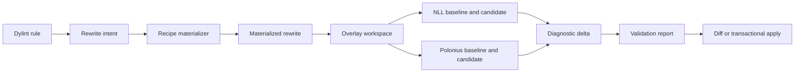

# RFC 0007: Compiler-validated rewrite checking

## Preamble

- **RFC number:** 0007
- **Status:** Proposed
- **Created:** 2026-08-30
- **Scope:** Compiler-based validation of candidate Rust source rewrites.
- **Related RFCs:** RFC 0008 and RFC 0009.
- **Precedence documents:** `docs/whitaker-cli-design.md`,
  `docs/ownership-shape-lints-design.md`, and any later accepted Architecture
  Decision Records (ADRs).

## 1. Summary

This RFC proposes a reusable rewrite checker for Whitaker. The checker accepts
a materialized source rewrite, constructs an isolated overlay workspace, and
compiles the unchanged and rewritten source under equivalent Cargo
configurations. It can run the candidate with both the ordinary non-lexical
lifetime (NLL) analysis and Polonius Alpha, using the same Rust compiler.

The checker classifies a candidate as:

- accepted by both NLL and Polonius;
- accepted only by Polonius;
- rejected by Polonius;
- accepted by NLL but rejected by Polonius;
- stale; or
- inconclusive because completed compiler runs could not be compared reliably.

The checker does not edit user source. It creates temporary session files and
runs compiler subprocesses inside an operating-system sandbox that denies
network access and limits writes to the session. It also does not claim
semantic equivalence merely because a rewrite compiles. Recipe-specific
reasoning and test validation remain separate responsibilities of the rewriter
proposed by RFC 0009.

The design deliberately reuses three planned Whitaker capabilities:

- the unified `whitaker` command-line interface (CLI);
- Phase 9 ownership-shape analysis; and
- Phase 11 overlay workspaces and per-target Cargo replay.

## 2. Problem

Green Continuous Integration (CI) proves that the checked-in source compiles.
It does not prove that the source expresses ownership directly.

Rust code, especially code produced by agents, may contain defensive ownership
workarounds introduced after an NLL borrow-check error:

- values cloned only to avoid an overlapping borrow;
- collection entries removed and reinserted;
- fields replaced with `Default::default()` and restored later;
- identifiers staged in temporary vectors before a mutation pass;
- read and write passes duplicated;
- owned snapshots retained only to read data while the original is mutated;
- lexical blocks or helper functions introduced solely to shorten a borrow.

A conventional lint can recognize these shapes. It cannot reliably determine
whether a proposed direct formulation:

1. still compiles under NLL;
2. compiles only under Polonius;
3. violates a real aliasing restriction; or
4. fails for a reason unrelated to borrowing.

The useful question is therefore counterfactual:

> Does a concrete rewrite compile under the configured checker, and does
> Polonius accept a rewrite that NLL rejects?

Answering that question requires a second compilation of rewritten source.
Running two borrow analyses inside a normal Dylint pass would couple Whitaker
to unstable `rustc_borrowck` internals and would still leave multi-file
rewrites, Cargo target selection, feature selection, build scripts, and path
dependencies unmodelled.

Whitaker needs an external compiler oracle with a stable input and output model.

## 3. Current state

Whitaker's ownership-shape design already proposes High-level Intermediate
Representation (HIR) prefiltering followed by Mid-level Intermediate
Representation (MIR) confirmation. It also distinguishes machine-applicable,
possibly incorrect, and diagnostic-only fixes.[^1]

The planned Phase 11 workspace analysis already proposes:[^2]

- temporary overlay workspaces;
- minimal text edits that never touch the working tree;
- `cargo metadata --format-version 1`;
- per-target `cargo check --message-format=json`; and
- diagnostic collection and classification.

The planned unified CLI makes `whitaker check` the product surface and already
owns Cargo invocation, target configuration, installation, output, and exit
status handling.[^3]

Cargo provides stable, versioned JSON for workspace metadata and build messages.
`RUSTC_WORKSPACE_WRAPPER` can wrap compiler invocations for workspace members
while preserving separate artefact hashes. These facilities provide a
sufficiently stable boundary for the checker.[^4][^5]

Polonius Alpha is a location-sensitive borrow analysis intended to accept NLL
problem case 3, conditional mutable borrows, and lending-iterator patterns. The
Rust project currently treats it as a superset of NLL, while retaining known
stabilization and soundness work.[^6]

## 4. Goals and non-goals

### 4.1. Goals

- Validate concrete, multi-file Rust rewrites without mutating the working tree.
- Compare NLL and Polonius with the same compiler, target, features, and Cargo
  resolution.
- Run every compiler-check subprocess in a sandbox that denies network access
  and prevents writes outside its session directory.
- Reuse one checker for existing ownership lints, the lints proposed by RFC
  0004, and future refactoring rules.
- Produce deterministic human-readable and JSON reports.
- Preserve pre-existing diagnostics through baseline-to-candidate comparison.
- Select the smallest sound Cargo target scope and escalate when a rewrite
  changes a signature or shared module.
- Cache baseline and candidate results without allowing one borrow-checker mode
  to contaminate another.
- Treat compiler acceptance as evidence of type and borrow correctness, not as a
  proof of behavioural equivalence.
- Remain usable when Polonius is unavailable by reporting the unavailable
  profile explicitly.

### 4.2. Non-goals

- Reimplement NLL or Polonius in Whitaker.
- Parse arbitrary compiler prose to infer developer intent.
- Prove semantic equivalence, panic equivalence, drop-order equivalence, or
  performance equivalence.
- Execute a complete test suite for every candidate by default.
- Rewrite source code. RFC 0009 owns materialization and application.
- Support legacy Datalog Polonius as a fallback for Polonius Alpha.
- Run Cargo build scripts or procedural macros outside the mandatory sandbox.

## 5. Terminology and invariants

### 5.1. Terminology

A **rewrite intent** is a semantic proposal emitted by a lint. It identifies a
recipe, source anchors, and evidence, but need not contain final text.

A **materialized rewrite** is a closed set of concrete UTF-8 text edits against
specific file contents.

A **checker profile** is one compiler configuration relevant to validation,
such as ordinary NLL or Polonius Alpha.

A **baseline run** compiles the unchanged overlay under one profile.

A **candidate run** compiles the overlay after applying one materialized
rewrite.

A **diagnostic delta** is the set of candidate diagnostics absent from the
corresponding baseline.

### 5.2. Invariants

The checker must preserve the following invariants:

1. NLL and Polonius runs use the same `rustc` binary.
2. A rewrite is checked only when every edited file matches its recorded
   content digest.
3. The source checkout is never modified.
4. Baseline diagnostics are not attributed to the rewrite.
5. Paths in reports are normalized back to workspace-relative paths.
6. Polonius-only acceptance requires an explicit Polonius Alpha profile. The
   checker must never silently substitute legacy Polonius.
7. A successful compile is reported as compiler validation, not semantic
   equivalence.
8. The report records the exact toolchain, target, feature set, Cargo arguments,
   and checker flags.
9. A candidate accepted by NLL but rejected by Polonius is preserved as a
   possible compiler regression rather than silently discarded.
10. Build configuration is immutable for the duration of a validation session.
11. Every process used by the checker runs in a sandbox with network access
    denied and writes confined to the session directory.
12. A missing or unenforceable sandbox is an error before Cargo is started; the
    checker never falls back to an unsandboxed process.

## 6. Proposed architecture

The following pipeline description serves as assistive text for Figure 1. A
Dylint rule emits a rewrite intent. RFC 0009 materializes that intent into text
edits. The checker copies the relevant workspace into an overlay, runs baseline
and candidate compilations, compares diagnostics, and returns a validation
report. RFC 0009 may then display or apply the candidate.



_Figure 1: Rewrite discovery, materialization, compiler validation, and
optional application._

### 6.1. Crate boundaries

The implementation should introduce two support crates.

```text
crates/
├── whitaker_rewrite_model/
│   ├── candidate.rs
│   ├── edit.rs
│   ├── invocation.rs
│   ├── report.rs
│   └── schema.rs
└── whitaker_rewrite_check/
    ├── baseline.rs
    ├── cache.rs
    ├── cargo.rs
    ├── diagnostics.rs
    ├── overlay.rs
    ├── profiles.rs
    ├── scope.rs
    └── session.rs
```

`whitaker_rewrite_model` must remain free of `rustc_private` dependencies. Lint
crates, the root CLI, and the rewrite engine can depend on it without importing
Cargo orchestration.

`whitaker_rewrite_check` owns overlay creation and compiler execution. It
should expose a library API so Phase 11 workspace analysis and RFC 0009 can
share the same implementation.

The root `whitaker` crate owns CLI parsing, configuration merging,
localization, and rendering.

### 6.2. Materialized rewrite model

The model should use whole-file digests plus byte ranges. Byte ranges alone are
unsafe after an intervening edit, while whole-file digests make stale plans
unambiguous.

```rust,no_run
pub struct MaterializedRewrite {
    pub schema_version: u16,
    pub id: RewriteId,
    pub rule: RuleId,
    pub summary_key: MessageKey,
    pub impact: ImpactScope,
    pub files: Vec<FileEditSet>,
    pub discovery: DiscoveryContext,
}

pub struct FileEditSet {
    pub path: WorkspaceRelativePath,
    pub base_sha256: Sha256Digest,
    pub edits: Vec<TextEdit>,
}

pub struct TextEdit {
    pub start_byte: u64,
    pub end_byte: u64,
    pub replacement: String,
}

pub enum ImpactScope {
    BodyLocal,
    ItemLocal,
    PackageTargets,
    ReverseWorkspaceDependencies,
    Workspace,
}
```

Edits within one file must be non-overlapping and sorted by their original byte
range. Application proceeds from the end of the file towards the beginning so
earlier offsets remain valid.

Before any source slicing or edit application, validate the complete plan.
Reject duplicate file paths rather than merging edit sets implicitly. For each
file, require `start_byte <= end_byte <= base_file_length`, UTF-8 boundaries at
both offsets, matching base-file digests, and sorted non-overlapping ranges.
Map deserialization and model-validation failures to
`RewriteCheckError::PlanValidation` at the checker boundary, preserving the
specific validation cause. Reject malformed plans before any file is sliced,
edited, or partially changed.

`DiscoveryContext` should record:

- package and target identity;
- active features;
- target triple;
- target toolchain;
- originating lint and lint-bundle version;
- the source span and enclosing item fingerprint; and
- any Cargo arguments forwarded by the user.

### 6.3. Validation request and result model

```rust,no_run
pub struct RewriteCheckRequest {
    /// One atomic rewrite group to validate in this request.
    pub rewrite: MaterializedRewrite,
    pub invocation: CargoInvocation,
    pub profiles: Vec<BorrowCheckerProfile>,
    pub gates: ValidationGates,
}

pub enum BorrowCheckerProfile {
    Nll,
    PoloniusNext,
}

pub enum RewriteAcceptance {
    NllAndPolonius,
    PoloniusOnly,
    AcceptedByNll,
    AcceptedByPolonius,
    RejectedByNll,
    RejectedByPolonius,
    RejectedByBoth,
    PoloniusRegression,
    Stale,
    Unavailable,
    Inconclusive,
}

pub enum ProfileOutcome {
    Accepted,
    Rejected,
    Unavailable { reason: String },
    Inconclusive { reason: String },
}

pub struct ProfileCheckResult {
    pub profile: BorrowCheckerProfile,
    pub outcome: ProfileOutcome,
    pub baseline: Option<CompilationReport>,
    pub candidate: Option<CompilationReport>,
    pub diagnostic_delta: Vec<NormalizedDiagnostic>,
}

pub struct CompilationReport {
    pub cargo_exit_status: ProcessExitStatus,
    pub child_process_statuses: Vec<ChildProcessStatus>,
    pub diagnostics: Vec<NormalizedDiagnostic>,
    pub outcome: CompilationOutcome,
}

pub enum ProcessExitStatus {
    Exited { code: i32 },
    Signaled { signal: i32 },
    TimedOut,
}

pub struct ChildProcessStatus {
    pub process: ProcessRole,
    pub exit_status: ProcessExitStatus,
}

pub enum CompilationOutcome {
    Completed,
    Inconclusive { reason: String },
}

pub struct InvocationProvenance {
    pub checker_version: String,
    pub model_schema_version: u16,
    pub compiler_identity: CompilerIdentity,
    pub cargo_version: String,
    pub target_triple: Option<String>,
    pub features: Vec<String>,
    pub effective_cargo_args: Vec<RedactedArgument>,
    pub checker_flags: Vec<String>,
    pub wrapper_chain: Vec<WrapperIdentity>,
    pub environment_fingerprint: EnvironmentFingerprint,
    pub digest: InvocationFingerprint,
}

pub struct RewriteCheckReport {
    pub rewrite_id: RewriteId,
    pub acceptance: RewriteAcceptance,
    pub profile_results: Vec<ProfileCheckResult>,
    pub invocation: InvocationProvenance,
}

pub enum RewriteCheckError {
    PlanValidation { cause: PlanValidationError },
    SandboxUnavailable,
    SandboxSetup { reason: RedactedReason },
    NetworkPolicyUnavailable { reason: RedactedReason },
    FilesystemIo { operation: FilesystemOperation, reason: RedactedReason },
    ProcessStart { program: ProgramIdentity, reason: RedactedReason },
    ProcessTimeout { program: ProgramIdentity },
    ClockUnavailable { reason: RedactedReason },
    ToolchainUnavailable { component: Option<String>, reason: RedactedReason },
    NetworkPolicyViolation { operation: RedactedReason },
    DependencyUnavailable { package: Option<String> },
}
```

`PlanValidationError` identifies malformed serialized or model data, including
invalid ranges, stale digests, duplicate paths, and overlapping edits. The
checker maps deserialization failures into `RewriteCheckError::PlanValidation`
before creating or editing candidate files; parser-specific errors do not
escape as unclassified failures.

`CompilationOutcome::Completed` means Cargo and every required child process
finished with enough evidence to classify their output. It does not mean that
rustc accepted the source: parsed rustc errors, including errors from a
baseline run with a nonzero Cargo exit, remain comparable diagnostics. The
candidate diagnostic delta decides whether a rewrite is rejected. A failed
build script, procedural macro, or wrapper; an unexplained nonzero exit; a
timeout or signal; or missing status for a required child process makes the run
`Inconclusive` or returns a typed process error. Such a run must never be
treated as an empty diagnostic delta. Profile reports retain process statuses
and the classification reason.

The checker is an application service with a small, checker-local set of
outbound capabilities: a capability-scoped filesystem for source snapshots and
session files, a sandboxed process runner, a monotonic clock for deadlines, and
a network-policy provider that supplies an enforceable deny-all policy. The CLI
composition root selects the operating-system adapters. Pure plan validation
and report classification remain ordinary data-to-data functions; the public
`whitaker rewrite check` command has side effects: it creates temporary files
and starts compiler processes, and it leaves user source untouched.

`RewriteCheckError` belongs to the `whitaker_rewrite_check` API, not the shared
model crate or the serialized `RewriteCheckReport`.

Keep these capabilities inside `whitaker_rewrite_check` and inject them at the
checker entry point. The CLI supplies the operating-system adapters; Phase 11
and RFC 0009 reuse the same checker library. The ports are not a new
repository-wide process or filesystem abstraction. Existing installer command
runners do not enforce this sandbox contract and must not be reused as the
checker process port. Environmental failures return
`Result<RewriteCheckReport, RewriteCheckError>` and produce a command error
with a stable error code and redacted detail. They must not be encoded only as
`RewriteAcceptance::Inconclusive` or `ProfileOutcome::Unavailable`. The latter
continues to describe a requested compiler profile that the sandboxed probe
actually found unsupported.

`profiles` must contain at least one unique profile. A profile result carries
its own baseline, candidate, diagnostics, and status, so JSON consumers never
infer profile identity from vector position. An unavailable capability probe is
serialized as `ProfileOutcome::Unavailable` with its reason and produces an
aggregate `Unavailable` result when that profile was requested. Failed or
non-reproducible compiler output is `Inconclusive` only after the sandboxed
process completed. Filesystem, sandbox, toolchain, process-start, clock,
deadline, dependency, and network-policy failures return `RewriteCheckError`;
they are not reported as compiler classifications.

`InvocationProvenance` records replay-relevant settings in structured fields as
well as their digest: resolved compiler and Cargo versions, target, features,
normalized effective Cargo arguments, checker flags, wrapper chain, and the
relevant environment fingerprint. Secret-valued arguments and environment
values are redacted or represented by a non-reversible digest; the report
remains replayable when the caller supplies credentials separately.

The report also records the sandbox provider, policy version, and effective
filesystem and network policy. An unavailable sandbox is reported as a command
error before a compiler report is created.

The serialized JSON envelope must carry a schema version. Unknown fields must
be ignored where safe. Unknown enum variants must cause a clear compatibility
error rather than being mapped to another meaning.

### 6.4. Toolchain resolution and capability probing

The checker must use the target workspace's effective toolchain, not the
toolchain used to build the Whitaker binary.

Resolution should follow this order:

1. an explicit `--toolchain` supplied to Whitaker;
2. the workspace's `rust-toolchain.toml` or `rust-toolchain`;
3. a directory override reported by `rustup`;
4. the caller's ordinary `cargo` and `rustc`.

The resolved compiler identity must include `rustc -vV` output and the Cargo
version.

Polonius support must be capability-probed once per compiler identity. The
probe should compile a tiny, known NLL problem case with the configured
Polonius Alpha arguments. Merely finding a flag name in `rustc -Z help` does
not prove that the desired behaviour is available.

Run `cargo metadata`, compiler identity commands, profile probes, Cargo, and
any existing compiler wrappers through the sandboxed process port. The
operating-system adapter must establish filesystem and network restrictions
before starting each child process and must terminate the complete process tree
when its deadline expires.

The initial `PoloniusNext` adapter should append:

```plaintext
-Zpolonius=next
```

The flag must live behind the profile adapter. A future stable preview or
feature gate should require changing one adapter rather than every caller.

If the probe fails, the profile result is `Unavailable`. The checker must not
fall back to `-Zpolonius=legacy`. A request selecting only one profile receives
`AcceptedByNll`, `RejectedByNll`, `AcceptedByPolonius`, or
`RejectedByPolonius`; it must not use comparison-only classifications such as
`PoloniusOnly` or `PoloniusRegression`.

### 6.5. Compiler wrapping

The checker should inject profile-specific arguments with a small
`RUSTC_WORKSPACE_WRAPPER`. This confines Polonius to workspace members and
allows dependency artefacts to be reused.

The initial implementation may rewrite only workspace-member packages. If a
materialized path resolves to a local path dependency that is not a workspace
member, reject it as an unsupported validation scope before invoking Cargo; the
current wrapper does not inject profile flags into that package. Add an
end-to-end fixture proving that such a rewrite is rejected. Dependency packages
may still be compiled unchanged as dependencies of a selected member.

The wrapper must preserve existing wrappers:

- an existing `RUSTC_WRAPPER`, such as `sccache`, remains in Cargo's outer
  wrapper position;
- an existing `RUSTC_WORKSPACE_WRAPPER` is invoked as an inner wrapper by
  Whitaker's wrapper; and
- user `RUSTFLAGS` and encoded flags remain unchanged.

Whitaker must record the composed wrapper chain in verbose diagnostics.

Every wrapper and its descendants run inside the same sandbox. Local wrapper
caches and temporary files must resolve under the session; do not expose a host
wrapper daemon, shared writable cache, or remote cache service. Preserve the
wrapper chain only when it can run under those restrictions. If it cannot,
return a typed process or policy error and do not retry outside the sandbox.

Using `RUSTFLAGS` globally is a supported fallback, but not the default,
because it rebuilds dependencies and can accidentally change build scripts or
procedural macros.

### 6.6. Overlay construction

The overlay engine should be shared with Phase 11.

The engine should:

1. create the overlay and per-session Cargo target under an operating-system
   temporary root outside the canonicalized source checkout;
2. run `cargo metadata --format-version 1` in a discovery sandbox with the
   canonical workspace and local path dependencies mounted read-only;
3. identify workspace members and local path dependencies needed by the
   selected targets;
4. copy manifests, lockfiles, Cargo configuration, toolchain files, sources,
   and required local assets into a session snapshot;
5. omit `.git/`, ordinary `target/` directories, and unrelated generated
   artefacts;
6. apply concrete edits only inside candidate copies of the overlay; and
7. assign separate session-local target directories to baseline and candidate
   runs.

The selected temporary root must not be inside the source checkout. If the
platform temporary directory resolves inside it, choose another
operating-system-managed temporary root or fail before copying. The discovery
sandbox mounts the canonical workspace and required local path dependencies
read-only and denies network access; it has no writable host paths. For
compilation, mount only the copied source inputs and the exact toolchain and
dependency caches needed, all read-only. Do not mount the canonical source
checkout or the caller's home directory into compiler processes. Within the
session, keep overlay sources read-only and allow writes only to dedicated
target, log, and temporary directories. Set `CARGO_TARGET_DIR`, build-script
`OUT_DIR` values, and temporary-directory variables to those session paths so
Cargo configuration cannot redirect writes to the host. Build scripts and
procedural macros are executable code supplied by the workspace or its
dependencies,[^7] so run them as untrusted code inside these restrictions: they
cannot write outside the session or access the network. If the platform cannot
enforce this policy, return `SandboxUnavailable` before invoking Cargo.

Source files must not be symlinked or hard-linked to the working tree. Build
scripts occasionally write into package directories despite Cargo guidance. A
symlink or writable hard link would therefore violate the no-mutation
invariant. Copy-on-write reflinks may be used when the platform guarantees
write isolation; otherwise ordinary copies are required.

The overlay should preserve relative path relationships between workspace
members and local path dependencies. Absolute paths in reports must be mapped
back to the original workspace.

### 6.7. Cargo invocation and target scope

The checker should derive a minimal sound scope from `ImpactScope`.

| Impact scope                   | Initial Cargo scope                                              |
| ------------------------------ | ---------------------------------------------------------------- |
| `BodyLocal`                    | Discovering package and target                                   |
| `ItemLocal`                    | All targets in the discovering package that can compile the item |
| `PackageTargets`               | All selected targets in the package                              |
| `ReverseWorkspaceDependencies` | Package plus affected reverse workspace dependencies             |
| `Workspace`                    | All selected workspace members                                   |

_Table 1: Initial Cargo scope selected from rewrite impact._

A body-local rewrite discovered in a library target should normally begin with:

```bash
cargo check -p <package> --lib --message-format=json
```

A private signature rewrite should compile every target in the package. A
public or cross-crate signature rewrite should include reverse workspace
dependencies. Rewrites touching workspace manifests, generated code, procedural
macros, or shared include files should escalate to the workspace.

The checker must preserve:

- `--features`, `--all-features`, and `--no-default-features`;
- `--target`;
- profile selection;
- `--manifest-path`;
- `--locked`, `--frozen`, or `--offline`;
- selected packages and targets; and
- relevant configuration passed after `--`.

Cargo invocations use `--locked` by default, including metadata and compiler
checks. `--offline` adds Cargo's offline dependency-resolution behaviour while
retaining `--locked`; `--frozen` means both locked and offline.[^8] Forwarded
Cargo arguments may add compatible selection and compiler settings, but may not
weaken Whitaker's locked default or contradict an explicit mode. Reject
conflicting policy flags before execution and canonicalize repeated identical
flags to one effective setting. Record the normalized effective arguments in
`InvocationProvenance` and use those same arguments in the cache fingerprint.
Cargo's `--offline` does not restrict network access by build scripts or
procedural macros; the required sandbox backend enforces that policy.

A report is valid only for the recorded configuration. It must not imply that
untested feature combinations or target triples were checked. The sandbox
denies egress regardless of Cargo's `--offline` setting. If Cargo cannot find a
required dependency in the available local cache, return an explicit
`DependencyUnavailable` or `NetworkPolicyViolation` error, as appropriate;
never retry without the sandbox.

### 6.8. Baseline and candidate runs

One `MaterializedRewrite` is one atomic rewrite group. A `RewriteCheckRequest`
validates exactly one group against one invocation and its requested profiles.
A caller with multiple groups submits separate checks and aggregates the
per-group reports. Those checks may reuse a baseline only when its complete
invocation fingerprint and checker profile match; each candidate remains
isolated to its own group.

Each validation session should create one cached baseline per invocation
fingerprint and checker profile.

The baseline run compiles the unmodified overlay. The candidate run starts from
the same overlay snapshot with exactly the request's one rewrite group applied.

Baseline compilation serves three purposes:

- it prevents pre-existing failures from being blamed on a rewrite;
- it detects non-reproducible feature or target selection; and
- it supports repositories that already contain Polonius-only code.

For an NLL-green repository, the baseline is expected to succeed. The design
must nevertheless compare diagnostic deltas rather than assuming success.

### 6.9. Diagnostic normalization

Cargo's JSON stream should be parsed line by line. Non-JSON output from build
scripts and procedural macros should be retained as unstructured log records
but must not crash the parser.

A normalized diagnostic key should contain:

```rust,no_run
pub struct DiagnosticKey {
    pub package_id: PackageId,
    pub target_name: String,
    pub target_kind: Vec<String>,
    pub level: DiagnosticLevel,
    pub code: Option<String>,
    pub primary_file: Option<WorkspaceRelativePath>,
    pub primary_start_byte: Option<u64>,
    pub primary_end_byte: Option<u64>,
    pub primary_start: Option<LineColumn>,
    pub primary_end: Option<LineColumn>,
    pub normalized_message_or_subdiagnostic: NormalizedDiagnosticContent,
}
```

Matching uses the diagnostic code, mapped primary span, and normalized message
or subdiagnostic content together. A message or subdiagnostic change at the
same code and mapped span is a diagnostic delta. Message text is never the sole
identity across toolchains. Before computing a delta, map candidate spans
backwards through the edit map to original byte coordinates when the entire
span lies in unchanged source. This keeps an unrelated baseline diagnostic
matched when an earlier edit shifts its line or column. A candidate span inside
replacement text has no baseline source anchor and remains a new diagnostic.
When a code or primary span is unavailable, the remaining normalized fields
still participate in matching; rendered prose alone is never sufficient.

Overlay paths, temporary target paths, and session identifiers must be removed
before comparison or serialization.

### 6.10. Classification algorithm

For each requested profile, a candidate is accepted only when baseline and
candidate runs are completed and classifiable, and the candidate's error
diagnostic delta is empty. Baseline rustc errors, even when Cargo exits
nonzero, remain valid comparison input and do not by themselves reject a
rewrite. Parsed new candidate rustc errors reject it. Failed build scripts,
procedural macros, or wrappers; unexplained nonzero exits; timeouts or signals;
and incomplete required process evidence are inconclusive or typed process
errors, never empty deltas. Sandbox and other environmental failures return
`RewriteCheckError`. Classification is relative to the baseline, not to an
assumption that the unmodified workspace is error-free.

When both profiles are requested, the checker classifies one candidate as
follows. `PoloniusRegression` is checked before the general two-profile
rejection case so it remains reachable.

```text
if source digests do not match:
    Stale
else if a required baseline run is incomplete or unclassifiable:
    Inconclusive
else if a requested candidate run is incomplete or unclassifiable:
    Inconclusive
else if a requested profile is unavailable:
    Unavailable
else if candidate NLL run has no new errors and candidate Polonius run has new errors:
    PoloniusRegression
else if candidate NLL run has no new errors and candidate Polonius run has no new errors:
    NllAndPolonius
else if candidate NLL run has new errors and candidate Polonius run has no new errors:
    PoloniusOnly
else if candidate NLL run has new errors and candidate Polonius run has new errors:
    RejectedByBoth
else:
    Inconclusive
```

When only one profile is requested, use its profile-specific accepted or
rejected outcome from §6.4. If a requested profile is unavailable, report
`Unavailable`; do not infer a cross-profile result from the remaining profile.

`PoloniusOnly` requires that every candidate error counted against NLL is
absent from the Polonius candidate. The report should include the NLL
diagnostic codes and spans, but it need not maintain a hard-coded list of
borrow-check error codes.

`PoloniusRegression` should produce a high-visibility diagnostic and preserve
the overlay and command log for reporting upstream.

### 6.11. Additional validation gates

Compiler checking always runs and is not represented by an optional gate flag.
Callers may request additional gates:

```rust,no_run
pub struct ValidationGates {
    pub compile_tests: TestScope,
    pub run_tests: TestScope,
    pub clippy: GateMode,
    pub rustfmt_check: GateMode,
}
```

The mandatory compiler baseline and candidate checks always run. This structure
contains only additional gates. The rewrite checker itself should default to
`cargo check` only beyond those compiler checks. RFC 0009 may request affected
tests or workspace quality gates before applying a rewrite.

Running tests under NLL when the candidate is intentionally Polonius-only is
not useful. Polonius-only candidates should run requested gates under Polonius
and retain the failed NLL check as portability evidence.

### 6.12. Caching

The cache key should include:

- workspace root identity;
- source tree digest for selected files;
- Cargo lockfile digest;
- Cargo invocation fingerprint;
- compiler identity;
- checker profile;
- wrapper-chain fingerprint;
- environment allowlist fingerprint; and
- rewrite edit digest.

Baseline results may be reused across candidates in one session. Candidate
results may be reused across repeated `diff` or `apply` commands while source
digests remain unchanged.

Every cache entry must include an explicit cache schema, checker implementation
version, materialized-model schema, and diagnostic-classification version.
Increment any component when its semantics change. The key must fingerprint the
complete transitive Cargo input set for the selected scope, including
manifests, lockfiles, dependency sources, build scripts, procedural macros,
generated inputs, relevant assets, and configuration. If the checker cannot
determine that input set completely, it must not reuse a cached result.

Cache entries should live outside the source checkout in the platform cache
directory and be safe to delete. The cache must never be the sole record of an
applied rewrite. `--offline` only controls Cargo dependency access; it does not
prevent network activity by itself. The mandatory operating-system sandbox
denies network access to Cargo, build scripts, procedural macros, and compiler
wrappers. Include the sandbox provider and policy version in the cache key.

### 6.13. CLI surface

RFC 0009 defines the complete rewrite command family. This RFC requires at
least:

```plaintext
whitaker rewrite check [OPTIONS] [-- <cargo args...>]

Options:
  --plan <PATH>                 Validate a serialized rewrite plan
  --select <SELECTOR,...>       Select rewrite-producing rules
  --profile <PROFILE>           nll | polonius-next | all
  --scope <SCOPE>               auto | target | package | reverse-deps | workspace
  --json                        Emit the versioned machine-readable report
  --keep-overlay                Preserve the temporary overlay for inspection
  --locked                      Require lockfile stability (default)
  --offline                     Use Cargo's offline dependency resolution
  --frozen                      Combine --locked and --offline
```

When `--plan` is omitted, RFC 0009 may discover and materialize candidates
before invoking the checker. `whitaker rewrite check` is the public command
name; `rewrite-scan` names the internal lint-session phase only. These names
must remain consistent with RFC 0008, RFC 0009, and the shared CLI design.

A concise human result should look like:

```text
BOR001 lookup_then_relookup
  source: crates/example/src/cache.rs:84:5
  result: accepted by Polonius Alpha; rejected by NLL
  NLL diagnostics: E0499 at 91:9
  checked: example/lib, default features, x86_64-unknown-linux-gnu
  rewrite: not applied
```

## 7. Requirements

### 7.1. Functional requirements

- Accept one materialized rewrite group per checker request; allow batches to
  submit groups as separate checks and aggregate their reports.
- Reject stale source digests before creating candidate builds.
- Reproduce the original Cargo selection.
- Run NLL and Polonius with the same compiler.
- Compare baseline and candidate diagnostics.
- Return a stable acceptance classification.
- Support package, target, reverse-dependency, and workspace scopes.
- Emit localized human output and stable JSON.
- Preserve overlays and logs on request or on unexpected divergence.
- Allow callers to request additional formatting, lint, and test gates.

### 7.2. Technical requirements

- Use `cargo metadata --format-version 1`.
- Consume `cargo check --message-format=json`.
- Keep the model crate free from `rustc_private`.
- Use capability-oriented filesystem access in production code.
- Store only workspace-relative paths in durable reports.
- Use deterministic maps and ordering for serialized output.
- Compose, rather than discard, user compiler wrappers.
- Keep NLL and Polonius artefacts distinct.
- Avoid global environment mutation in tests.
- Record all subprocess arguments and relevant environment variables in verbose
  logs with secrets redacted.

### 7.3. Safety and trust requirements

- Never write checker-controlled files into the source checkout.
- Never follow a rewrite path outside the workspace root.
- Reject overlapping edits.
- Reject edits that split a UTF-8 code point.
- Reject source generated by a macro unless a writable, user-authored call-site
  span is available.
- Never label compiler validation as semantic equivalence.
- Never auto-select Polonius-only acceptance as project policy.
- Confine Cargo, build scripts, procedural macros, and compiler wrappers to the
  mandatory filesystem and network sandbox.
- Fail before starting Cargo when the platform cannot enforce the sandbox.
- Default to `--locked`; support `--offline` and `--frozen`.
- Redact credentials and token-valued environment variables from reports.

## 8. Compatibility and migration

The checker is additive. Existing Dylint use remains unchanged.

Implementation should proceed in four stages.

### 8.1. Stage 1: Shared model and NLL checker

- Add `whitaker_rewrite_model`.
- Add overlay creation, the required sandbox adapter, and ordinary NLL
  baseline-to-candidate checking.
- Expose a library API without adding automatic rewrite discovery.
- Add sandbox integration fixtures proving that a malicious build script
  cannot write to the checkout or reach a network listener, and that sandbox,
  filesystem, process, and deadline failures reach the caller as errors.

### 8.2. Stage 2: Polonius profile

- Add toolchain capability probing.
- Add wrapper composition and `PoloniusNext`.
- Add `PoloniusOnly` and `PoloniusRegression` reports.

### 8.3. Stage 3: CLI integration

- Add `whitaker rewrite check`.
- Add JSON output and localized human reports.
- Reuse bundle and toolchain repair from the unified CLI.

### 8.4. Stage 4: Shared overlay consolidation

- Replace any duplicate Phase 11 overlay implementation with the common engine.
- Add reverse-dependency scope selection.
- Add cache reuse across workspace analyses and rewrite checking.

No accepted source rewrite should depend on RFC 0007 until the checker has
corpus coverage across representative workspaces.

## 9. Performance and resource use

The dominant cost is Cargo replay. The design should reduce it through:

- one baseline per profile and invocation fingerprint;
- workspace-only compiler wrapping;
- shared dependency artefacts;
- target-scoped checking;
- batching only independent candidates;
- candidate result caching; and
- lazy Polonius execution.

A likely fast path is:

1. materialize a candidate;
2. run the configured accepted checker;
3. run the alternative checker only when classification is requested.

For repositories configured to accept Polonius, the accepted-checker run may be
Polonius-first. NLL can then run only to report portability.

The CLI should report checker duration per candidate and aggregate cache hit
rates. This enables evidence-based decisions about whether the additional
compiler work improves agent throughput.

## 10. Testing strategy

Include a diagnostic-delta fixture where the baseline and candidate report
share a diagnostic code and mapped primary span but differ in normalized
message or subdiagnostic content. The changed content must appear in the delta;
matching must not use message text as the sole cross-toolchain identity.

### 10.1. Unit tests

Unit tests should cover:

- source digest validation;
- duplicate file-path rejection and edit-bound validation;
- non-overlapping edit enforcement;
- UTF-8 boundary checking;
- diagnostic normalization;
- delta computation;
- classification truth tables;
- invocation fingerprints;
- wrapper-chain composition; and
- deterministic JSON ordering.

### 10.2. Property tests

Property tests should generate sorted and unsorted text edits and verify that:

- accepted edit sets never overlap;
- reverse-order application equals the specified transformed text;
- stale digests always prevent application; and
- path normalization never escapes the workspace root.

### 10.3. Behaviour tests

Behaviour-driven tests should cover:

- an NLL-valid rewrite;
- a canonical NLL problem case 3 rewrite accepted only by Polonius;
- a rewrite rejected by both profiles;
- a simulated Polonius regression;
- a pre-existing baseline error;
- an edit before a pre-existing error whose source span remains unchanged;
- a multi-file signature rewrite;
- feature and target selection;
- an existing `sccache` wrapper;
- an unavailable Polonius profile; and
- overlay preservation.

### 10.4. End-to-end tests

End-to-end fixtures should include:

- a single-package application;
- a multi-package workspace with reverse dependencies;
- a path dependency outside the root package but inside the workspace;
- a candidate targeting a local path dependency that is not a workspace member;
- a build script;
- a procedural macro;
- a custom target directory; and
- a dirty working tree whose edited files still match the recorded digest.

Sandbox behaviour fixtures should also include a build script that attempts to
write to the original checkout and another path outside the session, then
assert that both writes are denied and the source remains unchanged. A second
fixture should attempt to reach a test network listener and assert that the
connection is denied. If the sandbox provider is unavailable or cannot
establish either restriction, assert that the command returns the matching
environmental error before Cargo starts. Inject filesystem, process, clock, and
policy failures and assert that each is surfaced as a command error rather than
only as an inconclusive report.

### 10.5. Corpus evaluation

Before promotion from experimental status, the checker should run against:

- Whitaker itself;
- Gauss;
- Weaver;
- ddlint;
- Lille;
- Netsuke;
- Stilyagi; and
- mxd.

The evaluation should record reproducibility, candidate latency, diagnostic
stability, and false classifications.

## 11. Alternatives considered

### 11.1. Run both analyses inside Dylint

This would avoid a second Cargo process, but it would couple Whitaker to
unstable borrow-checker internals, provide no natural multi-file source
overlay, and duplicate Cargo target and feature logic. It is rejected.

### 11.2. Use `RUSTFLAGS` for every compiler invocation

This is simple, but it recompiles dependencies and changes more of the build
than necessary. It remains a fallback, not the default.

### 11.3. Compile only a generated function fragment

A fragment loses imports, trait resolution, macros, type inference, associated
types, feature gates, and surrounding lifetime constraints. It cannot serve as
a trustworthy oracle.

### 11.4. Trust lint analysis without recompilation

HIR and MIR analysis can identify strong candidates, but the purpose of this
RFC is to resolve cases near the boundary of borrow-checker precision. Static
heuristics alone cannot provide the required evidence.

### 11.5. Use legacy Polonius facts

The legacy Datalog engine is not the target language behaviour and may accept a
different set of programs. Substituting it would produce misleading
classification.

### 11.6. Modify the working tree and run `cargo check`

This creates race conditions, interferes with editors and agents, and risks
losing uncommitted work. It is rejected.

## 12. Open questions

1. Should the first release always run both profiles, or run the accepted
   project profile first and the comparison profile lazily?
2. Should reverse-dependency scope include examples and benchmarks by default?
3. Should build-script and procedural-macro stderr participate in cache
   invalidation?
4. How should a workspace declare that Polonius-only source is acceptable:
   `whitaker.toml`, Cargo metadata, or both?
5. Should a retained overlay include a ready-to-run shell script reproducing
   every command?
6. Should non-deterministic compiler diagnostics trigger an automatic retry
   before `Inconclusive`?
7. Which operating-system sandbox providers should the first implementation
   support?
8. How long should validation reports remain compatible across Whitaker
   versions?

## 13. Recommendation

Whitaker should adopt the external overlay-based checker.

The compiler is the best available oracle for whether a concrete rewrite is
accepted under NLL or Polonius. The checker should therefore remain small in
semantic ambition and strict in reproducibility: exact edits, exact toolchain,
exact Cargo configuration, normalized diagnostic deltas, and no working-tree
mutation.

This checker should become shared infrastructure for Phase 11, the ownership
lints, the borrow-workaround lints proposed by RFC 0008, and the transactional
rewriter proposed by RFC 0009.

## References

[^1]: Whitaker ownership-shape lints design:
    `../ownership-shape-lints-design.md`

[^2]: Whitaker test-support overlay design:
    `../technical-design-for-test-support-dead-code-and-masked-dead-code-expectations.md`

[^3]: Whitaker CLI design: `../whitaker-cli-design.md`

[^4]: Cargo Book, "External Tools":
    <https://doc.rust-lang.org/cargo/reference/external-tools.html>

[^5]: Cargo Book, "Environment Variables":
    <https://doc.rust-lang.org/cargo/reference/environment-variables.html>

[^6]: Rust Project Goals, "Stabilize and model Polonius Alpha":
    <https://rust-lang.github.io/rust-project-goals/2026/polonius.html>

[^7]: Cargo Book, "Build Scripts":
    <https://doc.rust-lang.org/cargo/reference/build-scripts.html>, and Rust
    Reference, "Procedural Macros":
    <https://doc.rust-lang.org/reference/procedural-macros.html>

[^8]: Cargo Book, "cargo":
    <https://doc.rust-lang.org/cargo/commands/cargo.html>
